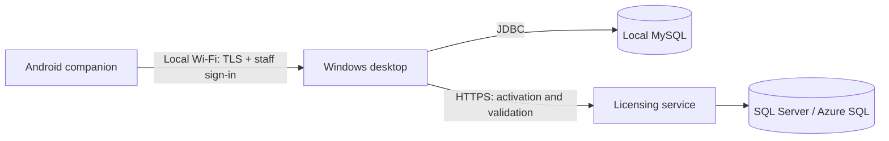

# Mbuyedzedzo
POS System

Mbuyedzedzo helps shops manage sales, inventory, stocktaking, promotions and business sessions. The Windows desktop app uses a local MySQL database. An Android companion provides barcode scanning, receipts and stock counts over the shop's Wi-Fi network.

## Documentation

| Start here | Contents |
| --- | --- |
| [Documentation index](pos-desktop/docs/README.md) | Current guides and historical change notes |
| [User guide](pos-desktop/docs/user-guide.md) | Installation, first login, daily sales, approvals and file locations |
| [Stocktaking](pos-desktop/docs/stocktaking.md) | Desktop/phone counts, Excel sheets and manager review |
| [Retail promotions](pos-desktop/docs/promotions.md) | Scheduled prices, multibuys, bundles, Excel imports and approval keys |
| [Troubleshooting](pos-desktop/docs/troubleshooting.md) | Setup, pairing, login, receipts and export problems |
| [Code architecture](pos-desktop/docs/code-architecture.md) | Packages, call flows, transaction boundaries and extension rules |
| [Database architecture](pos-desktop/docs/database.md) | Relationships, migrations, financial fields and the table dictionary |

These guides describe the current source. An older published installer or APK may not contain the same features. Update the desktop and phone together when changing the companion protocol.

## Components

| Component | Purpose | Development guide |
| --- | --- | --- |
| `pos-desktop` | Windows JavaFX till, database setup, inventory, staff, sessions, reports and receipts | [Desktop README](pos-desktop/README.md) |
| `mobile-scanner` | Android barcode scanner, product submissions, receipt history and stocktaking | [Android README](mobile-scanner/README.md) |
| `licensing-server` | Licence activation/validation API and browser administration | [Licensing README](licensing-server/README.md) |

Sales and inventory use the shop database. The phone connects to the desktop; it does not connect directly to MySQL. Licence activation and periodic online validation use the licensing service.

## Editions

- **Standard:** customer accounts, purchase history, customer reports and marketing alongside the core POS features.
- **Retail:** walk-in sales, with customer and marketing screens hidden. Sales use a shared walk-in account internally.

The edition is selected when building the desktop app. Standard and Retail use separate default schemas and edition-specific connection files. A licence must match the installed edition.

## Developer quick start

Run each command from the named component folder after completing that component's setup:

| Component | Requirements | Run |
| --- | --- | --- |
| Desktop | JDK 22, Maven, local MySQL or Windows setup flow | `mvn javafx:run` |
| Android | JDK 17, Android SDK 34, connected device/emulator | `.\gradlew.bat installDebug` |
| Licensing | JDK 21, Maven, configured SQL Server | `mvn spring-boot:run` |

See the component READMEs for configuration, packaging and tests. Building source does not publish a release or replace website downloads.

## Licence

This repository is not licensed for redistribution. Product activation and subscriptions are separate from permission to redistribute its source or binaries.
