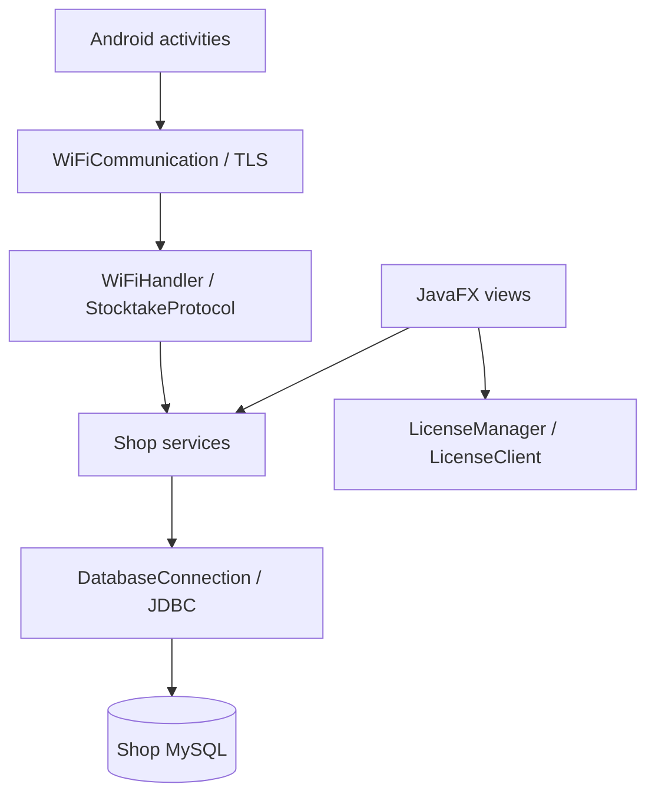

# Code architecture and maintenance

This is a map of the current source, not a claim that all code has been refactored into strict layers. Use the [desktop README](../README.md) for build commands, [database guide](database.md) for persistence and [user guide](user-guide.md) for screen instructions.

## Components and ownership

| Component | Entry points | Responsibility |
| --- | --- | --- |
| Desktop | `POSApplication`, `MainDashboard` | Startup, authenticated navigation, shop workflows and local phone listener |
| Android | `MainActivity`, `LoginActivity`, `WiFiCommunication` | Pairing, staff sign-in, scans, receipt storage and local stocktake drafts |
| Licensing service | Spring Boot controllers/services; Flyway SQL | Product licences, activations, storefront/admin accounts and associated commerce records |

The desktop's MySQL staff/customer records and the licensing service's SQL Server accounts are separate identities. The phone uses desktop staff credentials; it does not query MySQL directly or use a licensing-portal login.

## Startup and resource lifecycle

`POSApplication` coordinates logging, branding, terms, first-run database provisioning, schema setup, runtime-account migration, licence checks and login. `MainDashboard` chooses views according to staff role and edition. Some views are cached across navigation; follow their existing cleanup/listener ownership before attaching new callbacks or timers.

`DatabaseConnection` owns a lazy HikariCP pool. Close borrowed connections with try-with-resources. Saving connection configuration rebuilds the pool. `FirstRunSetup`/`WindowsMySqlProvisioner` are installation concerns; they do not belong in checkout or screen navigation.

The schema startup order is documented in [database migrations](database.md#schema-lifecycle). It runs again on subsequent launches, rather than relying on a one-time SQL import.

## Desktop package map

| Package | What belongs here |
| --- | --- |
| `views` | Screen construction, form inputs, action wiring and display state |
| `components`, `dialogs` | Shared forms, window presentation, icons/navigation and reusable interactions |
| `services` | Authorization, business validation, JDBC queries and transaction boundaries |
| `database` | Connection configuration, base schema, startup upgrades and database accounts |
| `models` | Objects used by UI/services; some workflow DTOs are nested records in services |
| `setup` | Windows provisioning, recovery and setup prompts |
| `license` | Activation client, signed token verification, machine identity and storage |
| `utils` | Formatting, documents, barcode generation, protected local secrets and logging |

Some services currently use `SalesView.CartItem`; the UI and service layers are therefore not completely independent. Preserve existing method contracts when changing these DTOs. A future shared basket model would require updating checkout, receipt generation and tests together.

## Checkout and promotion pricing

1. `SalesView` snapshots the basket and obtains a quote from `PromotionService`. Async total previews use a generation counter so an older result cannot replace a newer basket's display.
2. `PromotionService` loads approved definitions, applies South Africa date/code eligibility and compares any legacy basket coupon with retail offers.
3. `PromotionEngine` is a pure calculation: it consumes product IDs, regular prices, quantities, rules and a supplied time/code. It does not read the database, mutate stock or authorize a sale.
4. The engine enumerates eligible product-consumption patterns and chooses their best non-overlapping combination. It uses integer cents, bounded search and proportional allocations. A complexity-limit error must stay a failed quote, not fall back to an unadvertised approximate price.
5. `TransactionService.processPromotedTransaction` receives the displayed quote as an expectation, not trusted payment authority. On one database connection it rechecks staff, customer/session, approved rules, coupon usage, catalog prices and stock; mismatched quote signatures reject checkout.
6. Stock deduction, sale lines, promotion redemption evidence, coupon usage, sale/session linkage and totals commit together. Rows use paid unit prices; cent allocation can split a SKU into two unit prices.
7. Receipt creation/saving/email/phone delivery follows commit. A delivery failure must not cause a second sale. The receipt outbox has its own write transaction, so it is not an atomic part of checkout.

`SaleID` groups transaction rows; `TransactionID` identifies one paid-price line and is used for returns. Never assume one transaction row per SKU or multiply sale-level tender values by the number of rows.

## Approvals and stocktaking

`SupervisorAuthorization` verifies active Admin/Manager status and a salted, expiring, single-use code. Its connection-taking verification does not consume a code. The calling workflow consumes it only inside the transaction that saves the authorized action. Do not verify on one connection and consume on another.

`StocktakeService` captures immutable expected quantities and stock versions. Counts remain separate from live stock until approval. Desktop draft saves replace the counted set; phone unsubmitted edits also have local storage. Submission freezes the sheet and is retry-safe by UUID/status. Approval conditionally updates each counted product against both its loaded quantity and version, then records the reviewer and consumes the key. Any conflict rolls back the complete review. A quantity returning to its original value does not reset its version.

`FinancialApproval` locks the original paid line and request before validating remaining refundable quantity/value. Refunds settle in the active session where cash/card movement occurs. Equal-value exchanges write a replacement line and an exchange-credit return; they do not create new tender. `SessionMoney` excludes that replacement from received money and excludes exchange credits from refund cash flow. Unequal-value exchanges require a return and a new sale.

`SessionReview` and the session service maintain declaration/review state. Screen visibility is not authorization: retain database-side role/status checks when adding entry points.

## Companion protocol and Android state

`WiFiHandler` accepts bounded newline-delimited JSON over a `ScannerTls` identity. The connection QR pins its certificate fingerprint. `StocktakeProtocol` owns the socket's challenge, authenticated staff and token, including ownership/role checks. The name is historical: it now provides app-wide login, not a second stocktake-only account.

`WiFiCommunication` maintains transport across Android screens. Reconnects require staff sign-in. `ReceiptStorage` separates encrypted history by desktop/staff. `MobileReceiptService` queues a UUID/text message before transmission; phone storage precedes acknowledgement, and acknowledgement removes the pending row. An outbox is delivery state, not a permanent receipt archive. See the [Android README](../../mobile-scanner/README.md#protocol) for wire behaviour.

## UI and document conventions

Use `Theme`, `Ui`, `Icons`, `BrandAssets` and `SidebarBrand`. A table's View action should open organized labeled fields/actions directly. Keep validation errors and entered values available. Shared dialogs carry the theme and application icons; avoid independent palettes or image-backed buttons for ordinary controls.

JavaFX nodes belong to the FX thread. Send UI updates through `Platform.runLater` after background work. Follow existing dialog lifecycle patterns: opening a modal while another is being closed can interfere with the nested event loop. Avoid retaining completed baskets in post-commit error handlers.

Use `DocumentNames` for generated filenames and `SpreadsheetFiles` for workbook opening/size limits. Inventory imports maintain products; stocktake imports must retain snapshot identity/baselines; promotion imports create draft revisions. Those are different contracts even though they all use Excel.

## Extending and verifying the code

- A new offer type changes `PromotionEngine.Type`, generation/allocation, service validation, Excel columns/help, form controls and tests together.
- A schema change belongs in the startup owner and the [table reference generator](../tools/generate_database_reference.py). Review foreign-key deletion behaviour and legacy data explicitly.
- Financial changes need transaction/rollback tests against disposable MySQL, not just mocked SQL calls. Never use a shop database for fixtures.
- UI changes use shared controls and appropriate JavaFX rendering checks. Android JVM tests do not verify a physical camera or device layout.
- Doc-only edits do not require a full installer build. Comment changes should still compile; changed public contracts need meaningful tests.

See [desktop verification](../README.md#verification). Package-level Javadocs document persistence, service and view boundaries beside the code. The [database table dictionary](database-tables.md) can be regenerated without a running database.
