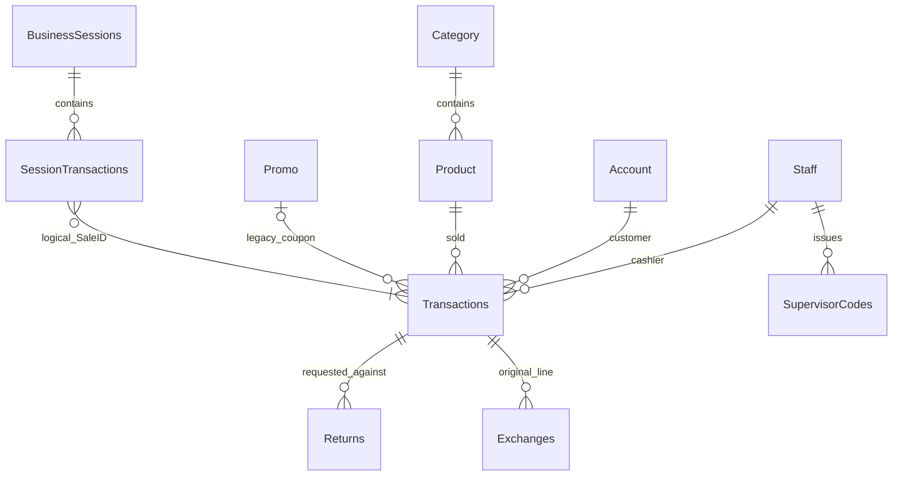
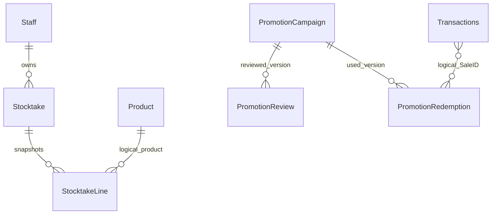

# Database architecture

This guide describes the schema implied by current source. It does not inspect a running shop or production licensing database. Read the [full MySQL column/constraint dictionary](database-tables.md) alongside this guide; do not reconstruct the current schema from the older reference SQL alone.

## Separate databases

| Store | Owner | Contents | Schema source |
| --- | --- | --- | --- |
| MySQL `pos_db_standard` / `pos_db_retail` by default | Desktop | Shop staff, products, sales, sessions, counts, offers, consent and receipt delivery | Java schema classes |
| SQL Server / Azure SQL | Licensing service | Portal customers/admins, licences, machine activations, orders and requests | Flyway `V1`–`V4` SQL |
| Protected local files | Desktop / Android | Connection/preferences, scanner identity, device drafts and receipt history | Component-specific storage classes |

There are no database foreign keys between the shop and licensing service. Licensing customers are organizations buying software; shop `Account` rows are customers buying goods. Android staff login uses shop `Staff`, not the licensing database.

## Schema lifecycle

[`DatabaseSetup.run()`](../src/main/java/com/pos/database/DatabaseSetup.java) executes in this order:

1. Connect to the configured schema, creating it only if absent. New schemas use `utf8mb4_unicode_ci`.
2. Repair legacy `SaleSequence` shape before seeding its pinned `id=1` row.
3. Create base tables and insert missing default settings/sequence seeds.
4. Add missing legacy columns, including product cost and coupon/consent fields; perform the guarded barcode-image regeneration.
5. Run `LedgerSchema.ensure`, which first invokes `PromotionSchema.ensure`, adds evidence/archive fields, widens supervisor-code hashes and replaces selected cascading foreign keys with RESTRICT.
6. Run `CompanionSchema.ensure` for stock versioning, stocktake snapshots and the receipt outbox.

These are repeatable startup checks. The desktop does **not** have a Flyway-style schema-version ledger, and `CREATE TABLE IF NOT EXISTS` does not reconcile arbitrary changes to an existing table. Add an explicit metadata-checked upgrade for a changed existing definition. Check code flags/settings when tracing one-time data repairs.

MySQL DDL can commit implicitly. Setup is not one all-or-nothing migration transaction; after a failure, earlier changes may remain. Back up before upgrading and test a restored copy. Runtime accounts need schema-local DDL/trigger permissions for later startups. Do not run migrations on the connection handling a sale.

## Relationship diagrams

These diagrams show workflow relationships, including logical links. **They are not all enforced foreign keys.** The dictionary lists actual constraints.





`SessionTransactions.SaleID` and `PromotionRedemption.SaleID` reference the sale group logically; there is no separate Sale header table. `StocktakeLine` has a real parent FK to `Stocktake`, but no Product FK, so its product/name/barcode/baseline evidence survives a missing catalog row. Stocktake staff/reviewer links and promotion evidence links are service-managed IDs, not declared FKs.

## Table responsibilities

| Area | Tables | Meaning |
| --- | --- | --- |
| Staff | `Staff`, `CheckIn`, `SupervisorCodes` | Staff credentials/roles, desktop login intervals and one-use approval hashes |
| Catalog | `Category`, `Product`, `AddInventory` | Product master data, current stock/prices/costs and restock records |
| Customers/consent | `Account`, `CustomerCommunications`, `MarketingSuppression`, `MarketingHistory` | Shop customers, current preferences, preference-change events and campaign delivery summaries |
| Sales | `Transactions`, `SaleSequence` | Paid-price lines grouped by SaleID and the serialized group counter |
| Adjustments | `Returns`, `Exchanges` | Requests, review decisions, paid-value credits/refunds and replacement links |
| Sessions | `BusinessSessions`, `SessionTransactions` | Business-session lifecycle, declarations, cash/card totals and sale membership |
| Legacy coupons | `Promo` | Existing whole-basket coupons and usage counters |
| Retail offers | `PromotionCampaign`, `PromotionReview`, `PromotionRedemption`, `PromotionGuard` | Draft/live definitions, immutable review/usage snapshots and publication/checkout serialization |
| Stocktakes | `Stocktake`, `StocktakeLine` | Count lifecycle and fixed per-product snapshots/counts |
| Delivery | `MobileReceiptOutbox` | Pending phone receipt UUID/text messages, deleted after acknowledgement |
| Shared settings | `BusinessSettings` | Database key/value defaults and shared business configuration; local folder/secrets preferences also use files |

Both editions retain the common schema. Retail uses a shared walk-in `Account`; hidden customer/marketing screens do not mean those tables are absent.

## Financial field semantics

| Field | Interpretation |
| --- | --- |
| `Transactions.TransactionID` | One ledger line at one paid unit price; return/exchange requests reference it |
| `Transactions.SaleID` | Shared group ID across a sale's lines, not a unique line ID or FK to a sale header |
| `Transactions.StaffID` / `OperatorID` | Attributed cashier / authenticated operator; nullable OperatorID identifies older records without this evidence |
| `Transactions.SalePrice` | Net unit amount actually charged after allocations |
| `Transactions.RegularUnitPrice` | Regular price snapshot for new checkout rows; older/other writers can leave it NULL |
| `Transactions.UnitCostAtSale` | Sale-time unit cost; NULL means unknown, not zero |
| `Transactions.AmountPaid`, `ChangeGiven` | Tender/change written once on a new sale's first line; other lines receive zero |
| `Transactions.PromotionSnapshot` | JSON charge snapshot: product/quantity, regular/paid unit prices, offer ID/name/revision |
| `Returns.SettlementSessionID`, `RefundMethod` | Session/payment channel where the approved refund actually moves money |
| `Returns.IsExchangeCredit` | Credit for an exchange's original line; excluded from cash/card refund movement |
| `Exchanges.NewTransactionID` | Ledger line for an approved equal-value replacement |

For revenue, sum `SalePrice * Quantity`; for tender, sum each row's `AmountPaid - ChangeGiven` once. Do not multiply tender by quantity or repeat sale-wide payment on every joined row. Joining multiple returns, offers or session memberships can multiply ledger rows; aggregate each relationship before combining totals.

New paid lines may split a SKU into two prices one cent apart. Refund eligibility follows the specific paid line and remaining approved quantities/value. Historical costs must not be backfilled from today's catalog. Product cost migration defaults old catalog costs to zero; that is not evidence that the shop acquired those goods free.

`SessionMoney` handles legacy tender fallback, excludes replacement exchange lines, and deducts ordinary approved refunds in their settlement session. General sale-period revenue and session cash movement answer different questions. Some promotion reports/usage counters are checkout-only and do not reverse discounts after returns; see [promotion reporting](promotions.md#checkout-receipts-and-returns).

## Transactions, locks and audit state

| Workflow | Atomic writes / conflict checks |
| --- | --- |
| Checkout | Staff/customer/session checks; guard + approved quote revalidation; coupon reservation; product price locks and stock; sale sequence/lines; redemption evidence; session link/totals |
| Return/exchange review | Reviewer/key/request/original line locks; remaining quantity/value; returned/replacement stock; ledger credits/replacement; decision; settlement totals; key consumption |
| Stocktake review | Reviewer/key/sheet; conditional product updates using expected quantity **and** version; decision/reviewer; key consumption |
| Offer save/publish | Batch draft validation and stable revision IDs; guard serializes publication with checkout; approved definition + review snapshot + key consumption |

The service owns commit/rollback on a single connection. A connection-taking helper must join that transaction rather than open its own. Receipt outbox insertion/delivery is separate from financial checkout; a committed sale can need receipt recovery if subsequent generation/delivery fails.

`SaleSequence.id=1` and `PromotionGuard.GuardID=1` are pinned singleton rows. `nextID` is a counter, never the sequence primary key. PromotionGuard provides row locking even when an offer list is empty, avoiding publication changes that a simple offer-row scan cannot lock.

## Stock versions and count states

The trigger `pos_product_stock_version` increments `Product.StockVersion` on each UPDATE that changes Quantity. It does not increment for an update leaving quantity unchanged. Stocktake snapshots copy `ExpectedQuantity` and `ExpectedVersion`; approval compares both. An intervening sale/restock/return is detectable even if stock later returns to the original amount.

`Stocktake.Status`: `Draft → Pending → Approved` or `Rejected`. CountedQuantity NULL means uncounted; zero is a counted empty shelf. Draft imports replace the counted set. Submitted snapshots are frozen by the service. These rules are not SQL CHECK constraints.

## Promotion definitions and statuses

`PromotionCampaign.Definition` stores the current draft Rule JSON. `PublishedDefinition` stores the approved version separately, so editing a draft does not change live prices. Rule JSON includes stable ID, name/type, inclusive-start/exclusive-end date-times, application limit, distinct flag, optional code, value, buy/get quantities, item groups and revision.

Persisted State is `DRAFT`, `APPROVED` or `DISABLED`. `SCHEDULED`, `ACTIVE`, `EXPIRED` and the draft-changes suffix are calculated labels, not extra persisted states. Offer eligibility uses `Africa/Johannesburg` whole-day boundaries.

`PromotionReview` stores APPROVE/DISABLE actions and the reviewed JSON. `PromotionRedemption` stores applications and savings for an offer/version at checkout, keyed by `(SaleID, PromotionID)`. JSON is stored in TEXT/MEDIUMTEXT, not native JSON columns; validation is application-managed. Legacy coupon IDs/codes remain in `Promo`/`Transactions`; modern offer history is in snapshots/redemptions.

## Constraints, deletion and limits

The base DDL contains cascading relationships later changed by `LedgerSchema`. Its selected tables (`Transactions`, `Returns`, `Exchanges`, `Product`, `Account`, `AddInventory`, `BusinessSessions`, `SessionTransactions`, `CheckIn`) have their existing CASCADE FKs changed to RESTRICT. SET NULL links are retained. Other tables' cascades are not globally rewritten.

Products/customers have `IsArchived` flags so history can remain. Do not infer blanket immutability or append-only enforcement: audit protections depend on service paths, runtime database privileges and the documented FKs. Promotion/stocktake snapshots deliberately have logical IDs without several catalog/staff FKs.

`Product.BarCode` remains a legacy LONGBLOB containing values read as strings. It has no declared unique barcode index in this schema. Several business constraints (positive quantities, valid roles/statuses, single active session, per-sale membership and approval rules) rely on application checks rather than SQL CHECK/UNIQUE constraints. Review raw imports/admin SQL with those limits in mind.

Base/companion tables explicitly use InnoDB. Promotion tables omit an ENGINE clause and inherit the server default; the financial workflow expects transactional tables. Confirm the deployed engine instead of assuming it from the Java class names.

## Credentials, time and deployment checks

Per-edition DB files are under `%PROGRAMDATA%\POS System\config`. Windows protects stored passwords. Local root connections are migrated to a generated schema-scoped account with migration DDL privileges. Local loopback JDBC disables TLS; remote JDBC uses identity verification. Phone TLS is a separate connection and does not encrypt local MySQL traffic.

Shop DATETIME values carry no time-zone metadata. JDBC defaults to fixed `+02:00`, with connection/session settings keeping local wall-clock values aligned. Promotions explicitly use South Africa time; ensure workstation clocks agree. Licensing migrations use DATETIMEOFFSET and UTC defaults instead.

Read-only checks for the selected shop schema:

```sql
SELECT DATABASE(), @@session.time_zone, @@default_storage_engine;
SELECT TABLE_NAME, ENGINE FROM information_schema.TABLES
 WHERE TABLE_SCHEMA = DATABASE() ORDER BY TABLE_NAME;
SHOW CREATE TABLE Transactions;
SHOW CREATE TABLE StocktakeLine;
SHOW TRIGGERS;
```

Use consistent backups of the complete shop database, not just Product/Transactions: snapshots, reviews, session membership and outbox state have related meaning. Restore/test using isolated credentials and copies of required local configuration. Protected Windows secrets and phone identity files need their own account-aware recovery planning. Never run destructive integration fixtures against a business database.

## Licensing database

Authoritative files: [V1](../../licensing-server/src/main/resources/db/migration/V1__init.sql), [V2](../../licensing-server/src/main/resources/db/migration/V2__commerce.sql), [V3](../../licensing-server/src/main/resources/db/migration/V3__license_requests.sql), [V4](../../licensing-server/src/main/resources/db/migration/V4__email_settings.sql). Flyway tracks applied versions; do not edit an already-applied migration to change a deployment.

| Migration | Tables/changes | Relationships and purpose |
| --- | --- | --- |
| V1 | `admin_user`, `customer`, `license`, `activation`, `transfer_log`, `audit_log` | Customer/issuer links on licences; machine activations and transfer history; portal audit events |
| V2 | Customer password/reset-token fields; `orders`, `transfer_request` | Orders reference customers/licences; transfer requests reference licence/customer/resolver |
| V3 | `license_request` | Public request, review, resolved customer/licence links |
| V4 | `email_settings` | Singleton `id=1` SMTP configuration, including encrypted password field |

Licensing IDs are generally BIGINT identity keys; email settings uses an explicit pinned ID. `license_key`, admin email, order reference and `(license_id,machine_fingerprint)` have uniqueness constraints. NVARCHAR stores text, BIT flags and DATETIMEOFFSET timestamps distinguish this schema from MySQL. Check migration SQL for actual FK deletion rules and indexes.

Schema support for orders or public requests is not proof that a payment gateway is configured or that a production flow has been acceptance-tested. See the [licensing README](../../licensing-server/README.md) and service code for runtime configuration.
